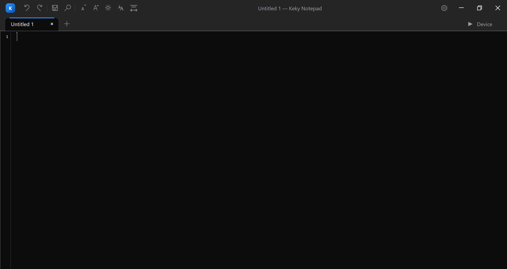
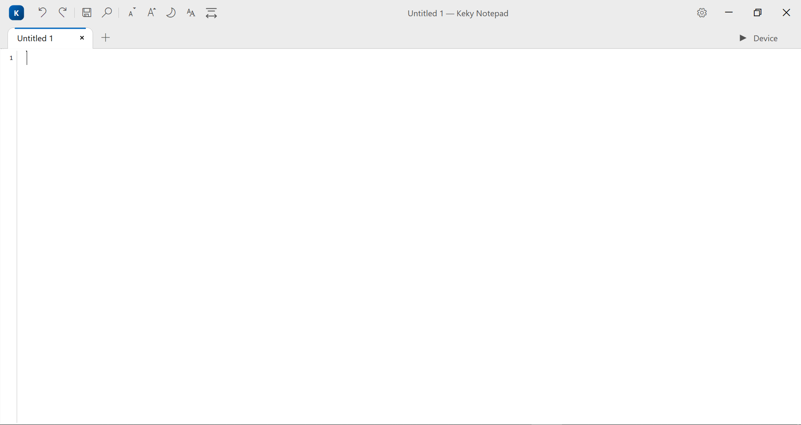
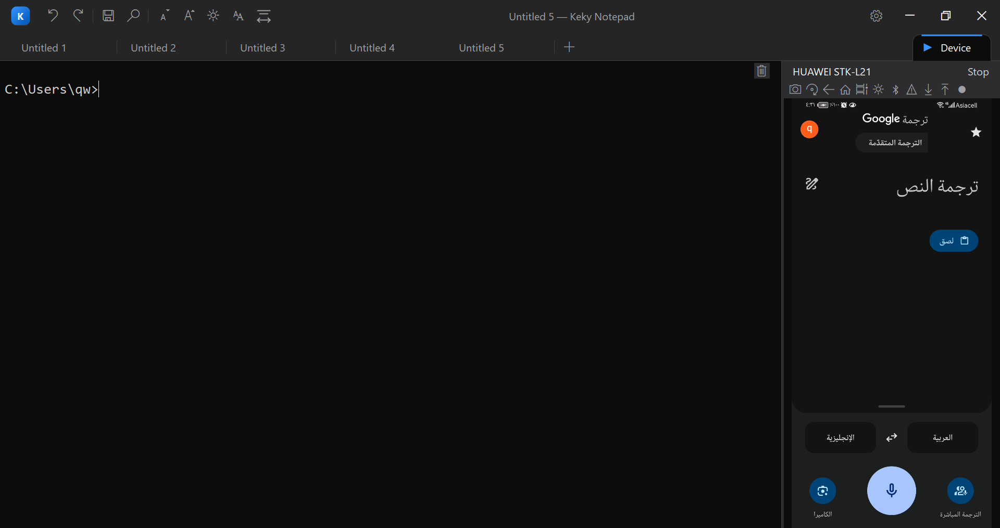
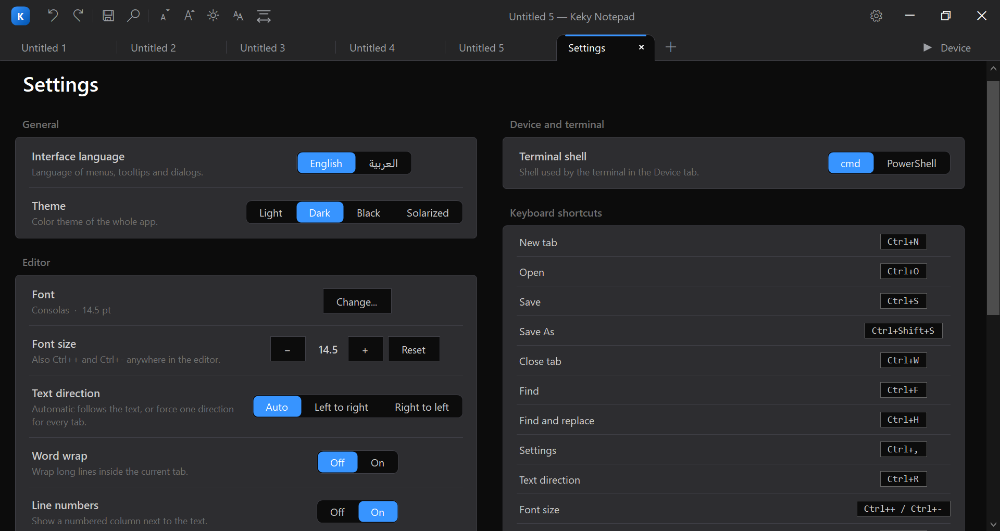
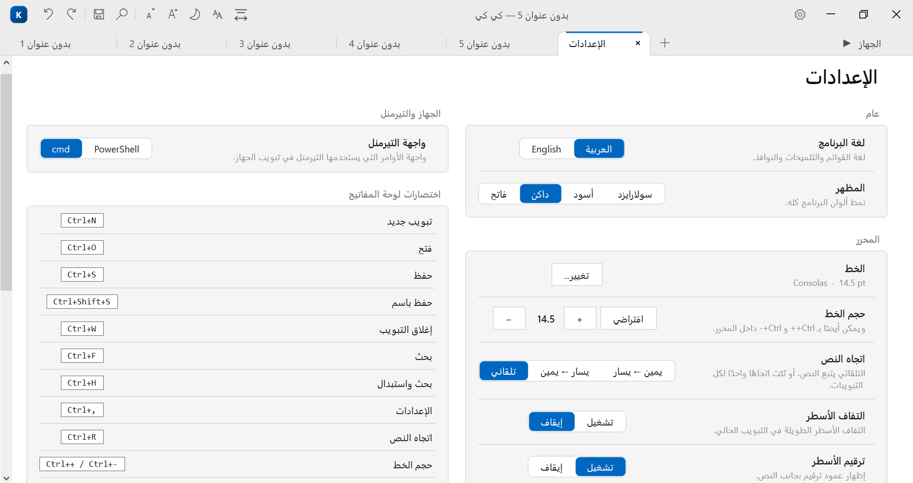

# كي كي | Keky 

[العربية](#العربية) · [English](#english)

<p align="center">
  
  
</p>

<p align="center">
  
</p>

<p align="center">
  
  
</p>

---

## العربية

**كي كي** برنامج **مفتوح المصدر** ومجاني: محرر أكواد ومفكرة ومشغّل هواتف عبر الشاشة، في تطبيق واحد لنظام ويندوز. يرتبط بالهاتف مباشرةً بوصلة USB واحدة. استفد أقصى استفادة وحقق إنتاجية أكبر.

[](LICENSE)  

### المزايا

**المحرر**
- تبويبات متعددة، مع استعادة التبويبات غير المحفوظة عند فتح البرنامج.
- حفظ تلقائي للملفات (اختياري).
- بحث واستبدال، وترقيم الأسطر، والتفاف الأسطر، وتلوين الصيغة.
- اتجاه النص تلقائي أو ثابت (يمين ← يسار / يسار ← يمين)، ويدعم العربية والإنجليزية معًا.
- تكبير وتصغير الخط بـ Ctrl + عجلة الماوس.
- أربعة ثيمات: فاتح، داكن، أسود، سولارايزد.
- واجهة بالعربية والإنجليزية.

**الجهاز والطرفية**
- عرض شاشة الهاتف والتحكم بها داخل البرنامج (scrcpy مضمَّن).
- دعم أكثر من هاتف في وقت واحد.
- لقطة شاشة، تدوير، أزرار الرجوع والرئيسية والتطبيقات الأخيرة، إطفاء الشاشة.
- تسجيل الشاشة، تثبيت APK، إرسال الملفات بالسحب والإفلات، عرض logcat.
- اتصال لاسلكي عبر Wi-Fi.
- طرفية مدمجة (cmd أو PowerShell) مع إكمال الأوامر وتلوين الأخطاء.

### التثبيت

1. نزّل `KekyNotepad-Setup.exe` من صفحة [Releases](#).
2. شغّله واتبع المعالج. لا حاجة لتثبيت .NET أو scrcpy.
3. اختياريًا: أضف `adb` و`scrcpy` إلى PATH لاستخدامهما من أي نافذة أوامر.

لتشغيل ميزة الهاتف: فعّل **خيارات المطور ← تصحيح USB** في الهاتف ثم وصّله بالحاسوب.

### اختصارات لوحة المفاتيح

| الاختصار | الوظيفة |
|---|---|
| Ctrl+N / O / S | جديد / فتح / حفظ |
| Ctrl+Shift+S | حفظ باسم |
| Ctrl+W | إغلاق التبويب |
| Ctrl+F / Ctrl+H | بحث / بحث واستبدال |
| Ctrl+, | الإعدادات |
| Ctrl+R | اتجاه النص |
| Ctrl++ / Ctrl+- / Ctrl+0 | حجم الخط |
| Ctrl+D | تبديل المظهر |
| ``Ctrl+` `` | الجهاز والطرفية |

### البناء من المصدر

المتطلبات: ويندوز 10/11 (x64) و[.NET 8 SDK](https://dotnet.microsoft.com/download).

```bash
# تشغيل للتطوير
dotnet run

# نسخة مستقلة (ملف واحد يتضمن .NET)
dotnet publish -p:PublishProfile=Portable

# المثبّت (يتطلب Inno Setup 6)
ISCC Installer\KekyNotepad.iss
```

ميزة الهاتف تحتاج ملفات scrcpy: نزّل [scrcpy v3.3.4](https://github.com/Genymobile/scrcpy/releases) وفكّ ضغطه داخل `Tools/scrcpy`.

### الترخيص

الشيفرة المصدرية متاحة للجميع: يمكنك استخدام البرنامج وتعديله وتوزيعه، حتى لأغراض تجارية، بموجب [Apache License 2.0](LICENSE). يُشترط الإبقاء على نص الترخيص وإشعارات حقوق النشر.

### المساهمة

المساهمات مرحّب بها: افتح [Issue](#) للإبلاغ عن خطأ أو اقتراح ميزة، أو أرسل Pull Request. أي مساهمة تُرسلها تُرخَّص بموجب Apache 2.0 أيضًا.

يستخدم البرنامج [scrcpy](https://github.com/Genymobile/scrcpy) وadb، وكلاهما بترخيص Apache 2.0. نصوص تراخيصهما في `Tools/licenses`.

---

## English

**Keky Notepad** is a free and **open-source** code editor, notepad and phone-screen mirror in one Windows app, connected to your phone through a single USB cable. Get the most out of your time and be more productive.

[](LICENSE)  

### Features

**Editor**
- Multiple tabs, with unsaved tabs restored on launch.
- Optional auto-save for files.
- Find & replace, line numbers, word wrap, syntax highlighting.
- Automatic or fixed text direction (LTR / RTL), with mixed Arabic and English text.
- Ctrl + mouse wheel to zoom the font.
- Four themes: Light, Dark, Black, Solarized.
- Arabic and English interface.

**Device and terminal**
- Mirror and control your phone inside the app (scrcpy bundled).
- Several phones at once.
- Screenshot, rotate, Back / Home / Recents, screen off.
- Screen recording, APK install, drag-and-drop file transfer, logcat.
- Wireless connection over Wi-Fi.
- Built-in terminal (cmd or PowerShell) with command completion and highlighted errors.

### Install

1. Download `KekyNotepad-Setup.exe` from [Releases](#).
2. Run it and follow the wizard. No .NET or scrcpy installation needed.
3. Optionally add `adb` and `scrcpy` to your PATH to use them from any terminal.

To use the phone feature, enable **Developer options → USB debugging** on the phone and plug it in.

### Keyboard shortcuts

| Shortcut | Action |
|---|---|
| Ctrl+N / O / S | New / Open / Save |
| Ctrl+Shift+S | Save As |
| Ctrl+W | Close tab |
| Ctrl+F / Ctrl+H | Find / Find & replace |
| Ctrl+, | Settings |
| Ctrl+R | Text direction |
| Ctrl++ / Ctrl+- / Ctrl+0 | Font size |
| Ctrl+D | Toggle theme |
| ``Ctrl+` `` | Device and terminal |

### Build from source

Requirements: Windows 10/11 (x64) and the [.NET 8 SDK](https://dotnet.microsoft.com/download).

```bash
# run for development
dotnet run

# self-contained single-file build (includes .NET)
dotnet publish -p:PublishProfile=Portable

# installer (needs Inno Setup 6)
ISCC Installer\KekyNotepad.iss
```

The phone feature needs the scrcpy files: download [scrcpy v3.3.4](https://github.com/Genymobile/scrcpy/releases) and extract it into `Tools/scrcpy`.

### License

The source code is open: you may use, modify and distribute Keky Notepad, including commercially, under the [Apache License 2.0](LICENSE). You must keep the license text and copyright notices.

### Contributing

Contributions are welcome: open an [issue](#) to report a bug or suggest a feature, or send a pull request. Any contribution you submit is licensed under Apache 2.0 as well.

It uses [scrcpy](https://github.com/Genymobile/scrcpy) and adb, both under the Apache License 2.0. Their license texts are in `Tools/licenses`.
